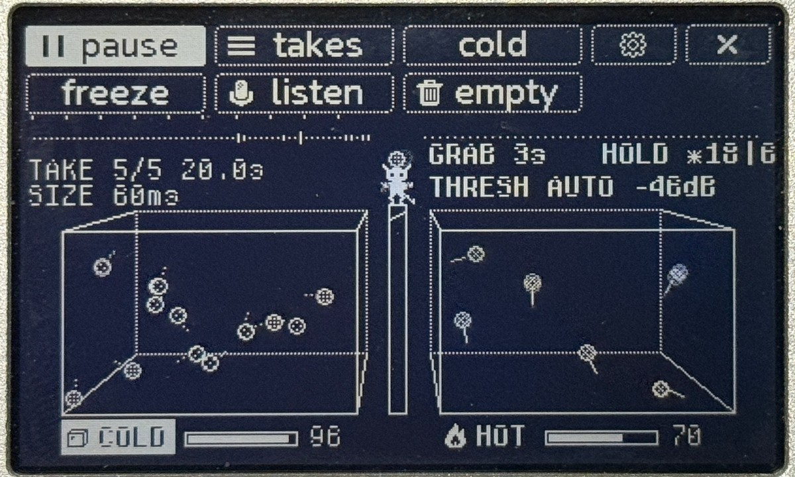
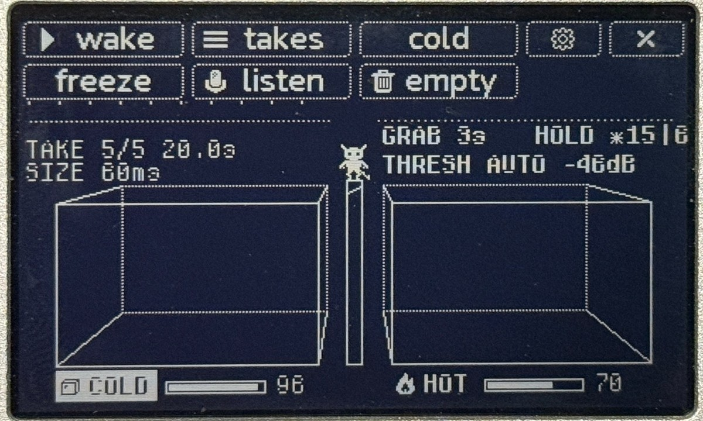
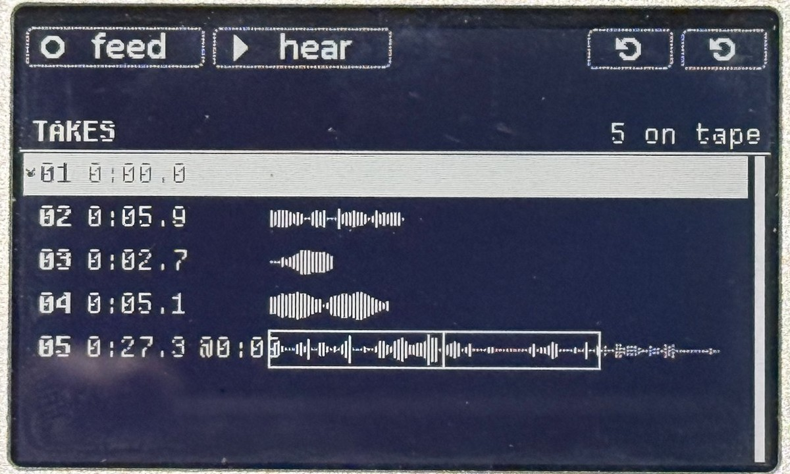
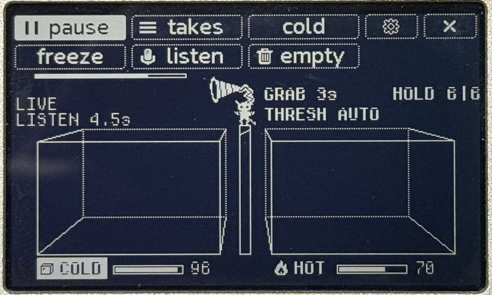
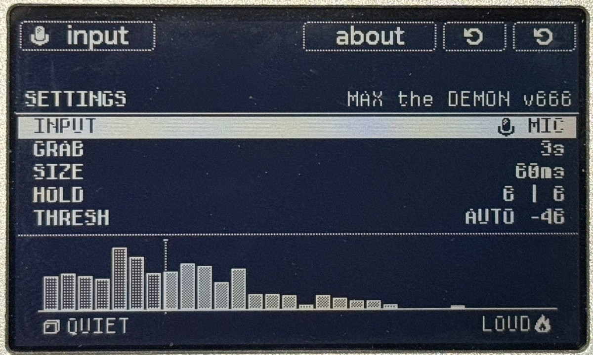
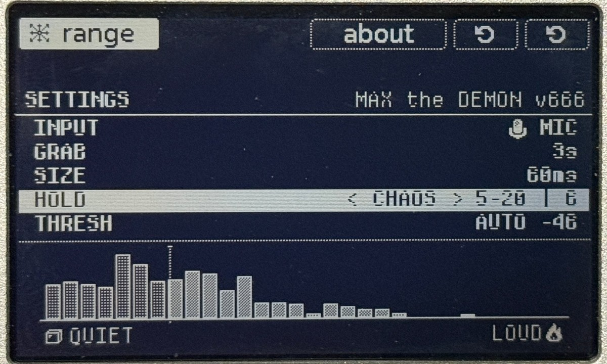
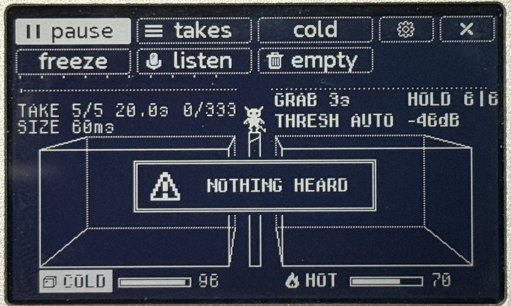

# MAX the DEMON: the Grimoire

Nov 6, 2026 · @SPIKE

## I. The Invocation

Know this, seeker: within your tape! there dwells a small black demon, horned and hoofed, and his name is **MAX**. He is the servant of an old thought, first spoken in **1867** by James Clerk Maxwell. In it, a tiny being stands at a door between two chambers and sorts the swift from the slow.

MAX sorts not molecules but **sound**. Feed him a recording and he tears it into grains no longer than a breath. He weighs each one by its loudness, then hurls it into one of two vessels: **COLD** for the quiet, **HOT** for the loud. There the grains bounce like trapped spirits. Each time one strikes a wall, it sounds.

What comes out is never the same twice. That is the bargain.

This grimoire describes **MAX the DEMON v666.1**, a tapp for the tape! by It's Your Bedtime.

## II. The Rite of Installation

To bind MAX to your machine:

1. Join the tape! to your computer with a **USB-C** cable. It appears as a drive.
2. Copy **max\_demon.tapp** into the tape!'s **apps** folder.
3. Eject the tape! and unplug it.
4. MAX dwells under **TAPE** in the tape!'s menu. To summon him, select **TAPE**, then press and hold **BTN1** (select) to open the app menu. Choose **MAX the DEMON**.

He wakes already sorting. To send him back, press **BTN5** and hold **BTN1** to confirm.

## III. The Two Vessels

MAX stands upon his pillar between two vessels, and this is the whole of his labor:

1. **He feeds.** The take he is given (up to its first 20 seconds) runs past him as a waveform, left of his pillar.
2. **He grabs.** Every **GRAB** seconds (3 s when he wakes) he reaches out and tears off one grain. Its length is the **SIZE** (60 ms when he wakes).
3. **He weighs.** He measures the grain's loudness. Grains quieter than -60 dB are silence, and he passes them by.
4. **He sorts.** A grain at or above the **THRESH** line goes to **HOT**; below it goes to **COLD**.
5. **He throws.** The grain flies into its vessel and bounces there.

Each vessel holds only so many grains, its **HOLD** (6 when he wakes). When a new one arrives in a full vessel, the oldest is cast out.

**Reading the vessels.** Every grain is a dot:

- **Size** of the dot = the grain's length (small for 10 ms, large for 500 ms).
- **Shading** = its loudness within the take; denser is louder.
- **HOT** grains move fast and trail speed lines. **COLD** grains drift slowly with dotted trails.
- A grain flashes and **sounds** each time it strikes a wall. It is panned by where it hits, with soft 3 ms edges so it does not click.

*MAX at work. COLD (left) is full of slow grains with dotted trails; HOT (right) holds the fast ones. HOLD ✶18|6 means COLD is breathing on CHAOS.*

Each vessel has its own volume, shown in the meter under it.

## IV. The Five Buttons

Five buttons and one knob command the demon. The bar along the top of the screen always shows what each button does at that moment.

*The bar at the top: the upper row is what each button does on a tap, the lower row on a hold. Here MAX rests, so BTN1 reads wake.*

| Button | Tap | Hold |
| --- | --- | --- |
| BTN1 | Pause MAX, or wake him. The vessels keep sounding while he rests. | **Freeze** everything: vessels stop, silence falls. Hold again to thaw. |
| BTN2 | Open the **TAKE** page to choose a recording (Chapter V). | **LISTEN**: MAX captures 6 s of live sound (Chapter VI). |
| BTN3 | Turn the knob's power between the **COLD** and **HOT** volume. | **Empty** both vessels. |
| BTN4 | Open **SETTINGS** (Chapter VII). | The tape!'s own main menu. |
| BTN5 | Banish MAX (hold BTN1 to confirm). | (the tape!'s own) |
| Knob | Turn the chosen vessel's volume, 0 to 100, 2 a click. Clockwise is louder; 70 is the grains' own level. |  |

To the right of MAX the screen shows his pace and his vessels' size, such as **GRAB 3s** and **HOLD 6|6** (COLD | HOT). Under the feed, left of his pillar, are the take's name, how far he has sorted, and the grain **SIZE**.

## V. Offerings: the TAKE Page

MAX feeds only on what you give him. **Tap BTN2** to see every take on your tape: its number, its length, and a waveform of what he would hear. The little horned head marks the take he is feeding on now.

| Control | What it does |
| --- | --- |
| Knob | Scroll the list (clockwise goes down). |
| BTN1 FEED | Give MAX the chosen take and return to the vessels. |
| BTN2 HEAR | Preview the take. Press again to stop. The vessels fall quiet, but MAX keeps sorting. |
| BTN3 SLIDE | Long takes only (see below). |
| BTN3 hold REV | Turn the take backwards. Hold again to turn it forwards. |
| BTN4 SPEED | Change the take's speed: 1x, 1/2, 1/4, 1/8, 1/16, 2x, then around again. |
| BTN5 | Go back, changing nothing. |

*The TAKE page: six takes on tape. Take 02 is set to 1/4 and take 06 to 1/16; slowed down, each runs past 20 s, so a box marks what MAX will eat. Take 04 wears the backwards triangle of REV. Under BTN3 waits **rev**, and BTN4 shows the chosen take's speed, 1x.*

**Long takes.** MAX handles at most **20 seconds** of a take. For a longer one, the waveform shows the whole take with a box around the 20 s he will eat. Tap **BTN3 SLIDE** and turn the knob to move the box, 1 second a click; the row shows where it starts (such as @0:41). Tap BTN3 again when done. HEAR and FEED both use the box. MAX forgets the box when he is banished, so cut long recordings into separate takes on the tape! itself.

### Speed and Reversal

The tape! decks can record at less than full speed. Such a take holds fewer moments of sound each second, and the decks play it back just as slowly, so it sounds true to you. MAX cannot know how fast a take was recorded. Left alone, he devours it at full speed, and it comes out **fast and high**, like a chattering imp.

Tell him the truth with **BTN4 SPEED**. Each tap moves the chosen take to the next speed: **1x → 1/2 → 1/4 → 1/8 → 1/16 → 2x**, then around again. If a deck recorded at half speed, set the take to 1/2 and it sounds as it did.

But a demon does not need to be told the truth. Set a full-speed take to 1/2 and MAX hears it an octave lower and twice as long, before his claws ever touch it. At **1/16** a single second of tape stretches into a long, low drone. **2x** does the reverse: faster, higher, and half as long.

**Hold BTN3** for **REV**, and the take runs backwards. REV works at any speed, and a held BTN3 turns it forwards again.

- **HEAR** plays the take at its speed and in its direction, so you can try it before you feed him. Change SPEED or REV while it plays and the preview starts over the new way. Backwards, the playhead runs right to left.
- A take at any speed but 1x wears its fraction in a small black box after its length. A take turned around wears a little backwards triangle. The BTN4 cell shows the take's speed, and the **rev** cell (under BTN3) lights up while REV is on.
- Lengths are shown as MAX will hear them: a 5-second take set to 1/2 reads 10 seconds. The 20 seconds he eats and the SLIDE box are measured the same way, so a slowed take is more likely to be a long one.
- On the vessels screen, the take's name carries its speed and REV, such as **TAKE 2/5 10.2s 1/2 REV**.
- MAX forgets SPEED and REV when he is banished, as he forgets the SLIDE box.

**An empty tape.** With nothing recorded, MAX waits in silence and the page reads **0 on tape**. This is not a fault. Record a take, or let him LISTEN.

## VI. The Listening

MAX can also take his meal straight from the air. He keeps an ear trumpet for this, and **MAX likes 6 seconds**.

1. **Hold BTN2.** The screen reads **READY**, and MAX holds his trumpet at his side. He keeps sorting.
2. **Let go.** The button's click is over before anything is heard.
3. **The countdown.** MAX raises the trumpet over a one-second **3, 2, 1**. The vessels fall quiet.
4. **He listens** for 6 seconds, then lowers the trumpet and begins to feed on what he heard.

*The Listening: trumpet raised, 4.5 s heard so far.*

He listens through the **INPUT** chosen in SETTINGS: **MIC** (the tape!'s own microphones, the default each time he wakes) or **LINE**. On MIC, he switches to the mics only for the countdown and the capture, then back to LINE so you can hear him.

If the air held nothing but hiss, he casts the capture away. **NOTHING HEARD** appears, and he returns to the take he was on.

## VII. The Book of Settings

**Tap BTN4** to open the book. MAX keeps sorting and the vessels keep sounding while you read it.

- **Knob**: move between the rows. While a row is being changed, the knob changes its value (clockwise is more).
- **BTN1**: start changing the row, and finish. The value being changed sits in brackets, `< like this >`.
- **BTN3**: open the **ABOUT** page. Any button closes it.
- **BTN4 / BTN5**: close the book and return to the vessels.

*The book as MAX wakes: MIC, 3s, 60ms, 6 | 6, AUTO.*

| Row | What it rules | Choices | When MAX wakes |
| --- | --- | --- | --- |
| INPUT | What LISTEN hears. BTN1 switches it at once. | MIC, LINE | MIC |
| GRAB | How often MAX tears off a grain | 0.5 s, then 1 to 13 s | 3 s |
| SIZE | Each grain's length | 10, 20, 30, 40, 60, 80, 120, 160, 250, 500 ms, or CHAOS | 60 ms |
| HOLD | Grains each vessel keeps, set for COLD and HOT apart | 3 to 40, or CHAOS | 6 \| 6 |
| THRESH | The line between COLD and HOT | AUTO, or -59 to 0 dB | AUTO |

MAX forgets all of these when he is banished, so each summoning starts fresh.

### The chart

Under the rows lies a picture of the whole take. Every grain stands by its loudness, from -60 dB on the left (QUIET, the ice) to 0 dB on the right (LOUD, the flame). Light shading goes COLD; dense shading goes HOT. The dotted line is THRESH.

**AUTO** puts the line at the middle of the take's loudness, so roughly half the grains go each way. Turn up from AUTO to set the line yourself, 1 dB a click. Turn back down past -59 to return to AUTO. A new line rules only the grains sorted after it.

### CHAOS in the SIZE row

Turn SIZE past 500 ms and you reach the **chaos sigil**. Each grain's length is then chosen at random between a low and a high (20 to 160 ms at first), with short and long equally likely. Press BTN1 again to set the low end, again for the high end, and again to finish. A vessel will hold a mix of sizes, and the dots show it.

### CHAOS in the HOLD row: the breathing vessels

The HOLD row reads `COLD | HOT`. BTN1 walks through it in order: COLD's value, then HOT's. Turn either value past 40 to reach **CHAOS**, and BTN1 then also asks for that vessel's low and high (5 to 20 at first).

*COLD's HOLD turned to CHAOS (5-20); the sigil in the corner offers its range next.*

A vessel on CHAOS **breathes**. Each time MAX throws a grain into it, its HOLD drifts up or down by up to 3, staying within the range. When it shrinks below what the vessel holds, the oldest grains are cast out. So the vessel swells and thins on its own, and COLD and HOT breathe apart. On the main screen, a small sigil marks a breathing vessel, and the number after it is its HOLD at that moment, such as **HOLD 12|✶14**.

## VIII. Omens and Silences

| Omen | Its meaning | The remedy |
| --- | --- | --- |
| Empty vessels, no message | The tape holds no takes. | Record a take, or hold BTN2 to LISTEN. |
| **TOO QUIET** | Every grain of the take is below -60 dB. | Feed him a louder take. |
| **TAKE TOO SHORT** | The take is too brief to cut a single grain. | Feed him a longer take. |
| **NOTHING HEARD** | LISTEN caught only hiss or silence. | Check INPUT in SETTINGS, move closer to the mic, then LISTEN again. |
| **RESTING** | MAX is paused. The vessels still sound. | Tap BTN1 to wake him. |
| **FROZEN** | Everything is stopped and silent. | Hold BTN1 to thaw, or tap it to wake MAX. |
| One vessel is silent | Its volume is at 0, or it holds no grains. | Tap BTN3 to choose that vessel, then turn the knob up. |
| A take from the decks plays fast and high | The deck recorded it at less than full speed. | Set its SPEED on the TAKE page to match (1/2 for a half-speed take). |
| Too hectic | The vessels are too full or MAX grabs too fast. | Lower HOLD or raise GRAB, or hold BTN3 to empty the vessels. |

*NOTHING HEARD: the capture held only hiss, so MAX went back to his take.*

One quirk of the tape! itself: with MAX awake, choosing him again from the main menu does nothing. Close the main menu to return to him.

## IX. Colophon

**MAX THE DEMON**, v666.1

- **Inspired by:** Maxwell's Demon Thought Experiment, circa 1867
- **Created by:** SPIKE the Percussionist
- **Studio:** the NoiZ Temple
- **Web:** manipulate.net
